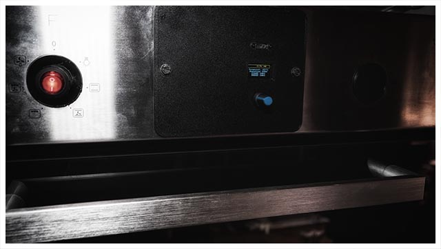
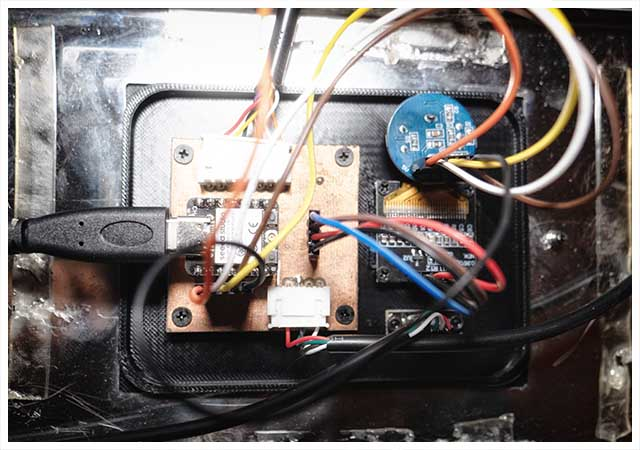
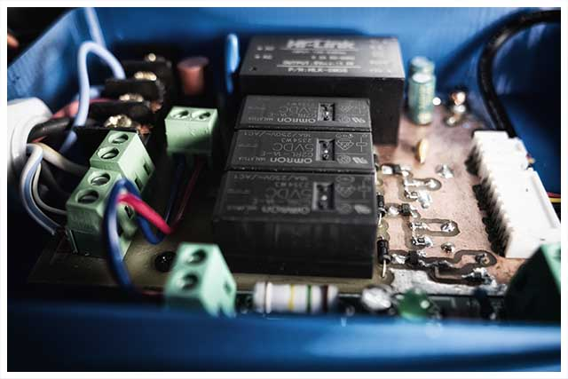
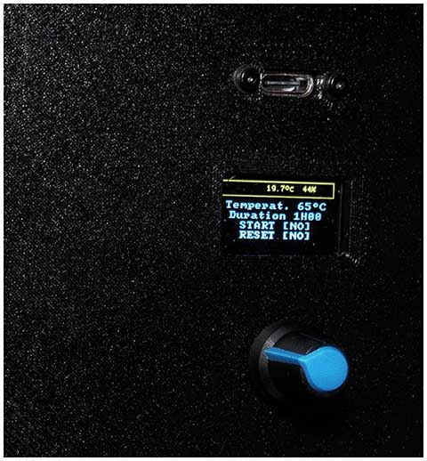

# DCS - Dryer Control System

A low-cost 3D filament dryer made from a repurposed old built-in convection oven (that is, an oven with a fan that circulates air to distribute the heat). The project includes the hardware (circuit boards), the software (the firmware), graphics, and the 3D print files for the enclosures created with OpenSCAD.

The oven I used is an old [Whirlpool AKP471/IX/01](https://www.whirlpool.fr/whirlpool-four-catalyse-encastrable-inox-akp471ix01-857747101530/p) (230V model, European only). 

Any 230V convection oven will work. The power supply is based on an HLK-5M05, which accepts an input voltage of 85 to 264 VAC, but I designed this project for 230 V, and I'm not sure if it will work properly and safely with 110 V.

&nbsp;

*front panel*

## Requirements

The logic hardware uses the small [SEEED STUDIO XIAO ESP32-C3 board](https://wiki.seeedstudio.com/XIAO_ESP32C3_Getting_Started/), a 128x64 bi-coloured (yellow/blue) SSD1306 display and an SHT31 breakout. The power supply unit uses an Hi-Link HLK-5M05, OMRON G2RL-1A-E-DC5 relays, AO3400A Mosfets, a few passive components, JST & other connectors. 

All the components were purchased from AliExpress and Mouser. The total cost is low: the oven was salvaged (one of the two heating elements was burned out), and the parts cost about 40€ (~44 US$) (including the 3D filament, copper plates & ferric chloride). 

&nbsp;

*Close-up of the enclosure containing the SHT31 inside the oven (printed in ASA)*

## Features

- Oven PID controlled firmware, with temperature prediction and duty cycle control (The PID must be fine-tuned based on the equipment, because the ovens heating elements have enormous thermal inertia)

- Designed for high thermal inertia devices

- Basic user interface using a rotary EC11 + touch switch & an SSD1306

## Firmware

- Project based on ESP-IDF 5.5.x & FreeRTOS.

- I'm using VS Code with the ESP-IDF extension

- The projet uses some older releases of my [embedded libraries](https://github.com/dcox69/libs "dcox69 libs"), in the [components](firmware/components/) directory.

## Hardware

see [README.md](hardware/ "Hardware")

&nbsp;

 
 *Back panel board*

&nbsp;

 
 *PSU board*

## Usage

&nbsp;

*front panel screen close-up*
&nbsp;

Rotate the EC11 to select an item, click to open that item, then rotate to choose from the options, and finally click to confirm. 

There are only two settings: temperature setting (5°C increments) and drying time (30-minute increments). The last settings used are saved in flash memory. 

When using the oven, leave the door slightly ajar so that humidity can escape and does not remain trapped inside the oven.
