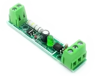

# DCS - Dryer Control System Hardware

A low-cost 3D filament dryer made from a repurposed old built-in convection oven. 

Contains the schematics for the two homemade PCBs (power supply and logic) into the Homemade/ folder. 

The double-sided PCBs are designed entirely for DIY fabrication using the iron method with thermal transfer paper and etched with ferric chloride. Large vias are used to connect one side to the other and link the ground planes.

The logic hardware uses the small [SEEED STUDIO XIAO ESP32-C3 board](https://wiki.seeedstudio.com/XIAO_ESP32C3_Getting_Started/), a 128x64 bi-coloured (yellow/blue) SSD1306 display and an SHT31 breakout. The power supply unit uses an Hi-Link HLK-5M05, OMRON G2RL-1A-E-DC5 relays, AO3400A Mosfets, a few passive components, JST & other connectors. For heater relay feedback, i've used an optocoupler module like this one :

 

All the components were purchased from AliExpress and Mouser. The total cost is low: the oven was salvaged (one of the two heating elements was burned out), and the parts cost about 40€ (~44 US$) (including the 3D filament, copper plates & ferric chloride). 

The oven I used is an old [Whirlpool AKP471/IX/01](https://www.whirlpool.fr/whirlpool-four-catalyse-encastrable-inox-akp471ix01-857747101530/p) (230V model, European only), and I only used the top heating element, which is rated at 1400W. At 230V, that’s about 6A, which is easily manageable. Of course, any 230V convection oven will work. The power supply is based on an HLK-5M05, which accepts an input voltage of 85 to 264 VAC, but I designed this project for 230 V, and I'm not sure if it will work properly and safely with 110 V. 

### *important notice*

> On the ESP32-C3, GPIOs 2, 8 et 9 are strapping pins. I'm using GPIO 8, which is LOW at boot on the XIAO ESP32C3 board. GPIO 9 is starting HIGH at boot (can be pulled LOW by the BOOT switch).
>
> The GPIOs 20 & 21 are used by UART, and they are pulled HIGH at boot, so the FAN & LIGHT relays are pulled ON at boot for a very short time. To avoid this, I should have used GPIO 8, 9, 20 or 21 for I²C (SDA/SCL), and GPIO 3, 4, 5, 6, 7, 10 for RELAYS & EC11, which is not enough. (EC11 needs 3 pins, and relays needs 4).
>
> So the XIAO ESP32C3 board was not the best choice for this project, a V2 logical board should be based on another board with more available free / non strapping GPIOs.

&nbsp;